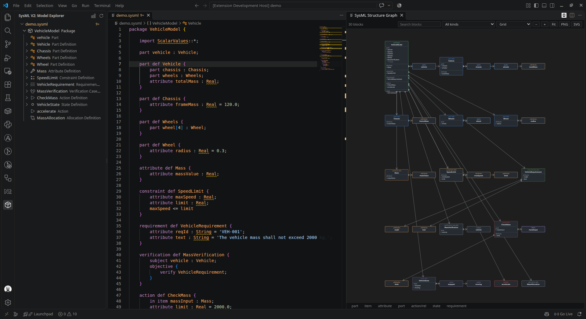

# SysML v2 for VS Code

Textual editing support for [SysML v2](https://www.omg.org/spec/SysML/2.0/) and KerML models in Visual Studio Code: syntax highlighting, live diagnostics, navigation, search, a model explorer tree, and an interactive structural graph view.

The extension ships its own TypeScript language server built on an ANTLR4 parser generated from the official OMG grammar. No Java runtime is required.



## Features

### Language support

| Feature | Description |
|---------|-------------|
| Syntax highlighting | TextMate grammar generated from the ANTLR lexer (173 keywords, 45 operator tokens) |
| Diagnostics | Syntax errors, duplicate declarations and unresolved references reported as you type |
| Outline and breadcrumbs | Full symbol tree for packages, definitions, usages, connectors, flows, states |
| Model Explorer | Tree view listing elements by file, following the containment hierarchy |
| Graph layouts and export | Layered, force, circle and grid layouts, plus PNG and SVG image export |
| Graph exploration | Search, kind filter, zoom and fit, selection details, in a full-width panel |
| UML blocks | Stereotype header, compartments with `name : Type [multiplicity]`, ports drawn on the block border |
| Traceability matrix | Requirements against verification cases, with unverified requirements called out |
| Rename | Rename a declaration and every resolved reference, across files |
| Code actions | Import a standard-library package, fix a misspelled name, add `ScalarValues` |
| Formatting | Normalise indentation and trailing whitespace, preserving comments and blank lines |
| Go to definition | On typing, specialization, subsetting, redefinition, crossing, import and alias references |
| Find all references | Across every file in the workspace |
| Hover | Kind, qualified name, owning namespace, and a marker when the target comes from the standard library |
| Workspace symbol search | `Ctrl+T` / `Cmd+T`, ranked prefix then fuzzy matching (library excluded to keep results focused) |
| Completion | SysML/KerML keywords plus in-scope, file-level and workspace symbols |
| Snippets | 40 templates for common constructs (`part def`, `package`, `requirement def`, `state def`, `calc def`, ...) |
| Bracket and comment config | `{}`, `[]`, `()`, `'...'`, `"..."`, `/* ... */` |

### Snippets

Type a prefix and press `Tab` (`Insert Snippet` via `Ctrl+Space` also works). Every snippet is verified by `npm test`, which renders the template with placeholder names and parses the result, so no snippet can emit invalid SysML.

| Prefix | Emits |
|--------|-------|
| `package`, `library package` | Package with an optional `library` prefix |
| `part def`, `part` | Part definition / usage |
| `item def`, `item` | Item definition / usage |
| `attribute def`, `attribute` | Attribute definition / usage with a default value |
| `port def`, `port` | Port definition / usage |
| `interface def`, `connect` | Interface definition / connection between features |
| `flow` | Item flow between two features |
| `action def`, `action` | Action definition with an input item / action usage |
| `state def` | State machine with entry action, nested state and transition |
| `calc def` | Calculation with input and return |
| `constraint def`, `constraint` | Constraint definition with an expression / inline constraint |
| `requirement def`, `requirement` | Requirement with `id` and `text` attributes |
| `concern def` | Concern definition |
| `analysis def`, `verification def`, `use case def` | Case definitions with subject and objective |
| `satisfy` | Satisfy requirement assertion |
| `allocation def` | Allocation definition |
| `view def`, `viewpoint def` | View / viewpoint definition |
| `enum def`, `metadata def` | Enumeration / metadata definition |
| `individual def`, `occurrence def` | Individual / occurrence definition |
| `import`, `import member`, `alias`, `dependency` | Relationship statements |
| `comment`, `doc` | Comment about an element / documentation comment |
| `root` | Package skeleton importing `ScalarValues::*` |

### Model Explorer

The **Model Explorer** view lists every element in the workspace grouped by file, following the containment hierarchy (packages, definitions, then nested usages). It refreshes automatically when files change or the server is restarted; use the refresh icon in the view title to force an update.

- Each file node shows the elements declared in it, in source order.
- The type of every element is shown as a description and reflected in the icon (part, item, attribute, port, action, state, requirement, ...).
- Click any element to jump to and select its declaration in the editor.

### Structure Graph panel

The graph is drawn as a block definition diagram (BDD) in SVG and refreshes automatically when the active editor or the model changes. It is shown in a full-width panel in the editor area, opened with **SysML: Open Structure Graph Panel** (also a button in the Model Explorer view title and the editor title bar). The panel is reused when it is already open.

- Nodes are SysML elements, colored by kind (part, item, attribute, port, action, state, requirement, ...).
- Dotted edges are containment; typed edges show `typed by`, `specializes`, `subsets`, `redefines`, `crosses`, `import`, `dependency` and `alias` relationships.
- Node count is bounded by the `sysml.graph.maxNodes` setting (default 300, truncation reported in the toolbar).
- **SysML: Export Structure Graph as DOT** writes a Graphviz file you can render with `dot`.

#### Exploration

| Control | Action |
|---------|--------|
| Search box | Highlights elements whose name contains the text; non-matching elements are dimmed. The status line reports the match count |
| Kind filter | Shows only elements of one kind, populated from the kinds present in the current file. Edges disappear with their endpoints |
| Zoom − / + | Zoom out or in around the centre of the view |
| Fit | Fit the whole graph into the view |
| Click a node | Selects it, centres it and shows its details (kind, child count, relationship count) |
| Double-click a node | Jumps to its declaration in the editor |
| Open in editor | Jumps to the selected element from the details panel |
| Click empty space | Clears the selection |

#### Layouts

The layout selector in the toolbar switches between four layouts:

| Layout | Description |
|--------|-------------|
| Layered (hierarchy) | Sugiyama-style layered layout from the containment edges (default). Crossing reduction and parent alignment keep large models readable |
| Force | Force-directed layout, best for seeing clusters of related elements |
| Circle | Elements arranged on a circle, compact for small models |
| Grid | Uniform grid, useful when comparing many similar elements |

#### Image export

| Button | Output |
|--------|--------|
| PNG | Raster image with a dark background, rendered at 2x for legibility |
| SVG | Vector image that stays sharp at any zoom level |

Both buttons open a save dialog and export the whole diagram, not just the visible area. The SVG is produced natively, so it stays sharp at any zoom level.

### Traceability matrix

**SysML: Open Traceability Matrix** opens a table of requirements (rows) against verification cases (columns). A check mark means the verification case references the requirement through `verify <requirement>;`; the panel also lists requirements with no verification. Clicking any name opens its declaration, and clicking an empty cell inserts `verify <requirement>;` inside the verification case body. The matrix refreshes when the model changes.

### Editing

| Feature | Behaviour |
|---------|-----------|
| Rename (`F2`) | Renames the declaration and every resolved reference, including other files. In a qualified reference only the segment naming the symbol is replaced (`Q::Base` becomes `Q::Root`). The rename is refused when the new name already exists in the same scope, or when the target belongs to the read-only standard library |
| Quick fixes | Unresolved reference offers the owning standard-library import, `import ScalarValues` for scalar types, the closest declared name for a near miss, and creation of the missing declaration. A comment offers extraction to a requirement; a requirement declaration offers a `satisfy` allocation |
| Format document | Re-indents from brace depth, trims trailing whitespace, collapses blank-line runs. Strings and comments are ignored when counting braces, so tokens and comments are preserved |

### AI assistance

The extension integrates with the editor's native language model API (`vscode.lm`) and the chat participant API, so no separate service or API key is required. Install and sign in to a chat provider such as GitHub Copilot; the commands report a clear message when no model is available.

**Inline assist.** `SysML: AI Edit Selection` (`Ctrl+Alt+I`, `Cmd+Alt+I` on macOS) sends the selection, or the whole file when nothing is selected, together with the declaration outline and cursor position. The answer is never applied directly: it opens in a diff editor first.

**Generate.** `SysML: AI Generate Declaration` (`Ctrl+Alt+Enter`) asks for a declaration to add at the cursor and proposes the insertion as a diff.

**Explain.** `SysML: AI Explain Model` (`Ctrl+Alt+E`) opens a read-only Markdown tab describing the main blocks, their relationships and suspicious constructs.

**Agent panel.** The **SysML Assistant** chat participant is available in the Chat view. It receives the same editor context automatically and supports `/explain` and `/generate`. When the answer contains a SysML code block, a **Preview change as diff** button appears.

**Diff review.** Proposals open in a normal diff editor with `Accept AI change` and `Reject` code lenses, and the notification offers the same two actions. Accepting applies a single full-document edit, so one undo reverts the whole change, and saves the file.

Every proposal is parsed by the language server before the diff opens. If the generated SysML has syntax errors, the assistant reports the first error and offers **Show errors** or **Propose anyway**.

| Setting | Default | Description |
|---------|---------|-------------|
| `sysml.ai.enable` | `true` | Enable inline assist, the chat participant and diff previews |
| `sysml.ai.model` | `""` | Preferred model family or id (for example `gpt-4o`); empty uses the first available model |
| `sysml.ai.maxContextChars` | `12000` | Maximum characters of the active document sent to the model |

## Getting started

```bash
npm install
npm run generate    # regenerate parser/lexer from grammar/*.g4 (needs Java 21)
npm run compile     # bundle extension, server and smoke test
```

Then press `F5` to launch an Extension Development Host, or package with `vsce package` (the `vscode:prepublish` script builds a minified production bundle).

Open any `.sysml` or `.kerml` file. The bundled normative standard library is indexed in the background at startup; until it finishes, cross-file references to `ScalarValues`, `Parts`, etc. may briefly report as unresolved.

### Building a `.vsix`

```bash
npm run vscode:prepublish
npx @vscode/vsce package
```

### Releasing

Push a tag that matches `package.json`:

```bash
git tag v0.1.0
git push origin v0.1.0
```

`.github/workflows/release.yml` runs the typecheck and the test suite, verifies the tag against `package.json`, builds the VSIX and attaches it to a GitHub release. Manual runs (`workflow_dispatch`) build and upload the VSIX as an artifact without creating a release.

## Settings

| Setting | Default | Description |
|---------|---------|-------------|
| `sysml.library.enable` | `true` | Index the bundled SysML/KerML normative standard library for cross-file resolution, hover and completion |
| `sysml.validation.unresolvedReference` | `true` | Report unresolved name references as warnings |
| `sysml.graph.maxNodes` | `300` | Maximum number of nodes rendered in the structure graph view |
| `sysml.server.path` | `""` | Path to a custom language server module; empty uses the bundled server |
| `sysml.ai.enable` | `true` | Enable the AI assistant, chat participant and diff previews |
| `sysml.ai.model` | `""` | Preferred model family or id; empty uses the first available model |
| `sysml.ai.maxContextChars` | `12000` | Maximum characters of the active document sent to the model |

## Commands

| Command | Description |
|---------|-------------|
| `SysML: Refresh Model Explorer` | Re-request the element tree from the language server |
| `SysML: Open Structure Graph Panel` | Open the graph in a full-width editor-area panel |
| `SysML: Open Traceability Matrix` | Open the requirements / verification matrix |
| `SysML: Refresh Structure Graph` | Re-request the graph for the active editor |
| `SysML: Export Structure Graph as DOT` | Save the current graph as a Graphviz `.dot` file |
| `SysML: Restart Language Server` | Restart the language server and re-index the workspace |
| `SysML: AI Edit Selection` | Rewrite the selection (or file) with the language model, shown as a diff |
| `SysML: AI Generate Declaration` | Generate a declaration at the cursor, shown as a diff |
| `SysML: AI Explain Model` | Explain the model in a read-only Markdown tab |
| `SysML: AI Preview Last Proposal` | Reopen the last chat proposal as a diff |

Layout selection and image export (PNG, SVG) are available from the buttons in the graph view toolbar. The chat participant **SysML Assistant** provides the same AI features from the Chat view.

## Development

| Script | Purpose |
|--------|---------|
| `npm run generate` | Regenerate ANTLR parser/lexer sources from `grammar/*.g4` |
| `npm run compile` | Bundle `dist/extension.js`, `dist/server.js` and the smoke test |
| `npm run watch` | Rebuild on change |
| `npm run typecheck` | Strict TypeScript check, no emit |
| `npm test` | Smoke tests, unit tests and an end-to-end language-server test |

`npm test` runs four layers:

1. `smoke`: parse every bundled example with the full LL strategy, index the standard library with SLL plus bail, and verify cross-file resolution.
2. `snippet-smoke`: render every snippet, parse the result, and fail on invalid SysML.
3. `unit-tests`: `node:test` coverage for formatting, model extraction (multiplicity, explicit `verify` refs, symbol kinds) and AI code extraction.
4. `lsp-e2e`: start `dist/server.js` over stdio and exercise `sysml/graph`, `sysml/traceability`, `sysml/validate`, formatting, rename and code actions.

## Design notes

- **Custom language server.** A TypeScript LSP server over stdio keeps the extension self-contained: no JVM, no external server binary. It uses `vscode-languageserver` and the official `antlr4` npm runtime.
- **Grammar provenance.** `grammar/SysMLv2Parser.g4` and `SysMLv2Lexer.g4` are converted from the OMG KEBNF specification by [daltskin/sysml-v2-grammar](https://github.com/daltskin/sysml-v2-grammar) (MIT). See `grammar/ATTRIBUTION.md`. One local patch makes the `visibilityIndicator` in `importRule` optional, matching the specification.
- **Fast library parsing.** The 94-file standard library is indexed with SLL prediction and `BailErrorStrategy` for speed, falling back to a full LL parse if prediction fails. Diagnostics are still computed with the full strategy for open documents.
- **Responsive indexing.** The indexer parses one file per turn, pauses when an LSP request is pending, and reports progress to the status bar, so the graph and hover stay usable during the initial library scan.
- **Shared protocol types.** `src/shared/protocol.ts` is imported by the language server, the extension host and the webview, so a payload change cannot silently desynchronise the two sides.
- **Typed webview.** `src/webview/graph.ts` is compiled by esbuild to `media/graph.js`; the diagram is plain SVG with no third-party runtime.
- **Explicit traceability links.** `verify` and `satisfy` statements are recorded as their own reference kinds instead of being inferred from generic subsetting.
- **Block definition diagram.** Blocks are drawn as SysML rectangles with a stereotype line, a name and compartments for parts, attributes, ports, actions, states and requirements. Relationships use standard notation: filled diamond for composition, hollow triangle for generalization, open arrow for typing and dependency. The renderer is plain SVG with no third-party library, so the diagram is exportable as true vector graphics.
- **Layouts.** Tree, force, circle and grid are computed directly in the webview. The tree layout uses containment edges only, otherwise cross-references would flatten the hierarchy.
- **One graph, one host.** The panel is owned by `SysmlGraphPanel` with a shared `GraphSession` that handles graph fetching and webview messages. Views are registered at the very start of `activate`, before the language server starts.
- **ANTLR runtime quirks.** The JS runtime exposes `Token.column`, `ParserRuleContext.parentCtx`, `_errHandler` and `_interp.predictionMode`; the TypeScript definitions are incomplete, so a few narrow casts are used. The ESM build of `antlr4` uses `import.meta`, so `esbuild.mjs` aliases the package to its CJS distribution.

## License

GPL-3.0-or-later. See [LICENSE](LICENSE).

The SysML v2 specification grammar is owned by the Object Management Group (OMG); this project ships a derived ANTLR4 translation. The normative standard library under `library/` is redistributed from the OMG SysML v2 Release.
